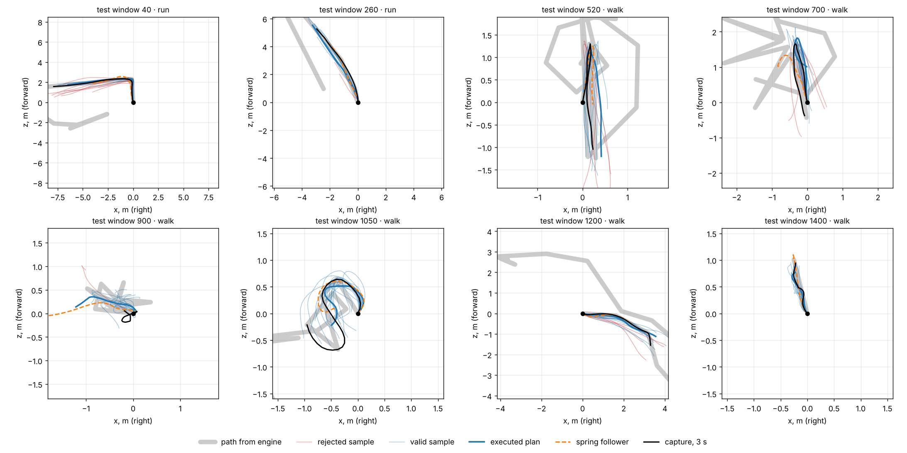

# Root-motion layer

Branch `feat/root-motion-layer`. Paired with the branch of the same name in
[LLM-NPC](https://github.com/QizhouD/LLM-NPC).

## What changed and why

The navigation MVP tried to learn pathfinding. That is a solved problem in games
(NavMesh), and the MVP could not beat a straight line on its own benchmark: its
expert labels collided with obstacles in 48.9% of episodes, the flow model's
samples were rejected 100% of the time, and nothing was trained on real motion.

The new split:

| Question | Answered by |
|---|---|
| Where to go | The engine's NavMesh. It sends path corners. |
| How to move along that route | This package: speed profile, corner rounding, facing, coming to rest. |
| Is the plan walkable | The engine again, by ray-casting each plan segment on the NavMesh. |

The research question becomes: *does a learned root-motion layer between NavMesh
and animation move an NPC more like a person than classical path following, within
a real-time budget?*

## Data

[LAFAN1](https://github.com/ubisoft/ubisoft-laforge-animation-dataset) (Ubisoft La
Forge), locomotion clips only: 18 clips, 73.5 minutes, five actors, gaits `walk`,
`run`, `sprint`.

**Licence: CC BY-NC-ND 4.0.** Research use only. Never commit the archive, the BVH
files or the extracted tracks; `.gitignore` covers `data/lafan1/` and `data/*.npz`.

```powershell
python -m gtp.rootmotion.fetch_lafan1 --output data/lafan1
python -m gtp.rootmotion.extract --bvh-dir data/lafan1 --output data/lafan1_root.npz
```

`extract` reads only the root joint, projects the hips to the ground, smooths with a
0.5 s cubic Savitzky-Golay filter, and resamples to 10 Hz in Unity's convention
(x right, z forward, yaw = atan2(x, z)).

### How a training window is built

Each window has 2 s of history, a 3 s future, a gait label and a **path**. The path
is what a NavMesh would give: a coarse polyline with no timing. It is recovered from
the capture by simplifying the trace the actor went on to walk (Ramer-Douglas-Peucker,
tolerance 0.1 to 0.4 m in training, 0.25 m in evaluation). The path ends with a goal
flag where the actor stops for at least one second; otherwise it is cut at 25 m or
16 vertices and flagged as continuing.

So the model must supply exactly what a polyline lacks. By construction the capture
stays within the simplification tolerance of its own path, which means **the
reference passes the runtime constraints 100% of the time**. The old benchmark's
labels failed its own filter half the time.

Split by actor: subjects 1 to 3 train (24,180 windows), subject 4 validation (1,737),
subject 5 test (1,441). Training mirrors windows left to right at random.

## Model

`RootMotionModel` generates 30 steps of `(dx, dz, dyaw)`. Three deliberate changes
from the MVP's flow model:

1. Targets are normalised (step std is about 0.095 m against unit noise before).
2. The output is 30 time tokens through a Transformer decoder, not one flattened
   vector through an MLP.
3. History (20 tokens) and path (up to 16 tokens) are read by cross-attention
   instead of being mean-pooled.

Velocity, speed and angular velocity are derived from the three generated channels,
so an exported plan cannot be kinematically inconsistent. The same network with
`deterministic: true` is the regression baseline.

## Planner and constraints

`RootMotionPlanner` draws K samples, rejects the invalid, executes the first valid
one (rejection sampling, which keeps the model's distribution), and otherwise falls
back to the spring follower, then to standing still.

- **Corridor (swept, with a bound).** Each 0.1 s segment is sub-sampled four times.
  Distance-to-path is 1-Lipschitz, so if every sample is within
  `half_width - spacing / 2`, the whole continuous trajectory is within
  `half_width`. The check includes the current position. This is a guarantee about
  deviation from the supplied path; walkability is verified in the engine.
- **Kinematics.** Speed 8 m/s, acceleration 20 m/s², turn rate 10 rad/s, including
  the jump from the current velocity to the first step.

## Preliminary results

CPU-sized model (587k parameters, 24 epochs, about 20 minutes on two cores), one
seed, held-out subject 5: 1,441 windows (976 walk, 465 run, no sprint).
Reproduce with:

```powershell
python -m gtp.rootmotion.train --config configs/rootmotion_flow_cpu.yaml
python -m gtp.rootmotion.train --config configs/rootmotion_regressor_cpu.yaml
python -m gtp.rootmotion.evaluate --config configs/rootmotion_flow_cpu.yaml `
  --flow runs/rootmotion_flow_cpu/best.pt `
  --regressor runs/rootmotion_regressor_cpu/best.pt --output results/rootmotion_cpu_test.json
```

| Method | ADE m | minADE@16 m | W1 speed | W1 accel | W1 turn rate | Stop error m | Fallback | P50 ms |
|---|---|---|---|---|---|---|---|---|
| Constant speed on the polyline | 0.563 | – | 0.400 | 1.006 | 0.550 | 0.126 | – | – |
| Spring follower | 0.577 | – | 0.304 | 0.774 | **0.198** | **0.111** | – | – |
| Regressor + filter | **0.410** | – | 0.250 | 0.652 | 0.567 | 0.338 | 9.6% | 2 |
| Flow, K = 16 + filter | 0.449 | **0.227** | **0.199** | **0.314** | 0.302 | 0.359 | 0.2% | 38 |

ADE compares positions at matching timestamps over 3 s, so it scores the speed
profile as well as the shape. W1 is the Wasserstein-1 distance between pooled
per-step distributions and the capture (m/s, m/s², rad/s). Stop error is the
distance from the final position to the goal on windows where the capture comes to
rest; the capture itself scores 0.104. Latency is one request on two CPU threads.

What this does and does not show:

- The pipeline works end to end: 0.2% fallback against 100% for the MVP, and every
  executed plan satisfies both constraints.
- The flow model is closer to the capture than both classical followers on speed
  and acceleration distributions, and its best of 16 samples halves the spring's ADE.
- **It loses to the spring follower on two things**: turn-rate realism and stopping
  on the goal (0.36 m against 0.11 m). Both need fixing before any claim of being
  better overall.
- This is one seed, a 20-minute CPU model, three test clips from one actor, and no
  sprint in the test set. Treat every number as provisional.



The figure also shows a data limitation: LAFAN1 was captured in a roughly 7 by 12 m
volume, so long paths fold back over themselves (windows 520, 700 and 900). A
self-overlapping path weakens the corridor check and makes the task ambiguous.

## Service

```powershell
python -m gtp.rootmotion.service --checkpoint runs/rootmotion_flow_cpu/best.pt --port 8787
```

`POST /plan`, world space, Unity convention:

```json
{
  "history": [{"position": [10.0, 0.0, 20.0], "yaw": 0.0}],
  "path": [[10.0, 0.0, 20.0], [10.0, 0.0, 23.0], [13.0, 0.0, 23.0]],
  "path_ends_at_goal": true,
  "gait": "walk",
  "corridor_half_width": 0.5,
  "candidates": 16
}
```

`history` is up to 20 poses at 10 Hz, oldest first; fewer are padded as standing.
The response is the existing `TrajectoryPlan` (31 points, the first being the
current pose at `t = 0`) plus `source` (`model`, `spring_fallback` or `hold`),
`rejected_candidates`, `candidates` and `latency_ms`. `fallback` is true only for
`hold`.

## Next steps

1. Full-size run on a GPU (`configs/rootmotion_flow.yaml`), three to five seeds.
2. Fix arrival: add a goal-distance term or classifier-free guidance on the goal
   flag, and report stop error against the spring.
3. Fix facing: generate facing relative to the direction of travel, or smooth it.
4. More data with open floor space (AMASS locomotion, 100STYLE) so paths stop
   folding; add HumanML3D text for real language conditioning. These need your own
   licence agreement and download.
5. Closed-loop evaluation in Unity with `RootMotionMetricsLogger`, against the real
   NavMeshAgent, including a moving target.
6. Body layer: drive a full-body model from the planned root, then measure foot
   sliding and run a small perceptual study.

## Legacy

The navigation MVP (`gtp.train`, `gtp.evaluate`, `gtp.planning`,
`gtp.data.synthetic_navigation`) is unchanged and its tests still pass. It is kept
for the record and is not part of the new direction.
